# 制作与装配指南(Assembly Guide)

> 面向复刻者:从物料准备到整机验收的完整流程。
> 本文按**实拍装配顺序**编排,每一步给出对应的现场照片与检查点。
> 电子设计文件见 [`../Hardware/`](../Hardware/README.md),固件见 [`../Firmware/`](../Firmware/README.md)。
> 16 张装配实拍图与章节的对照索引见文末「附录:实拍图索引」;成品界面截图见
> [`../Images/Product/`](../Images/Product/)。

## 1. 准备工作

**工具**

- 焊接:SMT 建议钢网 + 回流(或热风台 + 锡膏);插件用恒温烙铁(建议 ≥60 W,配小刀头，例如T12-KU)、
  助焊剂、吸锡线、清洗剂(见下方说明);
  - **清洗剂不要用无水乙醇**:它会和助焊剂里的有机酸发生酯化反应,生成很难洗掉的酯;
  - 推荐**石油醚或氯仿(三氯甲烷)**,但两者都有毒性,必须在通风处使用并戴手套/护目镜;
- 测量:万用表(通断/阻抗)、可调直流电源(**必须带限流**)、电子负载(测试用);
- 装配:镊子、尖嘴钳、斜口钳、M2十字螺丝刀、高温胶带;
- 烧录:**WCH-LinkE**(或 USB 直连 + WCHISPStudio),USB Type-C 数据线;
- 可选:热像仪/热电偶(温升验证)、放大镜/显微镜(检查 0.5 mm 间距的 FPC 焊点)。

**资料**

- Gerber(打样):`Hardware/Manufacturing/Gerber/*.zip`——**主板 / 背板 / 内面板 / 外面板 4 块都要打样**;
- 贴片坐标:`Hardware/Manufacturing/CPL/*.csv`——**仅主板 / 内面板**需要使用;
  背板与外面板为无元件面板板,没有电子 BOM,也没有贴片坐标文件;
- 原理图:`Hardware/Preview/SCH_*.pdf`;网表:`Hardware/Preview/Netlist_*.tel`;
- 交互式 BOM:`Hardware/Manufacturing/BOM/InteractiveBOM_*.html`(浏览器直接打开,
  点击 BOM 行即在 PCB 图上高亮定位,支持翻面);
- 设计源工程:LCEDA Pro `Hardware/source/ProPrj_*.epro2`。

## 2. 整机构成

整机成品:**85.3 × 50.0 × 20.6 mm**(长 × 宽 × 高,含外壳)、**95.4 g**(含外壳与风扇)。
装配前可先量一下外壳与板子的配合余量,尺寸对不上说明买错型材或板厚不对(见 §3 工艺表)。

本项目共 **4 块 PCB**,打样 4 块都要做,但只有主板与内面板有电气设计:

| 板卡 | 作用 | 元件 | 电子 BOM / 贴片坐标 |
|---|---|---|---|
| 主板 | 控制 + 功率级核心板(输入 OR-ing、SW3538 + 2×SW3526) | SMT + 插件 | 需要(`CPL/..._主板.csv`) |
| 内面板 | 屏幕/按键板:0.78″ OLED + 阻容 + 2 个轻触按键 | SMT + 手工焊接 | 需要(`CPL/..._内面板.csv`) |
| 外面板 | 白色丝印前脸:显示屏窗口、ENTER/NEXT 按键孔、三个输出口开孔 | 无 | 不需要 |
| 背板 | 背面结构板 | 无 | 不需要 |

**输入 / 输出端口**(装配与验收时对照):

| 位号 | 丝印 / 器件 | 说明 |
|---|---|---|
| DC 输入 | `CN1`,XT30UPB-M(板端公头) | XT30 直流输入 |
| PD 输入 | `USB4`,USB-C 母座(U264-141N,插件) | USB-C PD 输入,EPR 最高 28 V / 5 A |
| 输出 A+C | `USB1`(USB-A 母座,插件)+ `USB2`(Type-C,贴片) | 共用 SW3538,两口合计 ≤140 W |
| 输出 C1 | `USB3`(Type-C,贴片) | SW3526 #1,≤65 W |
| 输出 C2 | `USB5`(Type-C,贴片) | SW3526 #2,≤65 W |

> 端口能力与协议支持见 [`USER_MANUAL.md`](USER_MANUAL.md) §4,电源树见
> [`../Hardware/README.md`](../Hardware/README.md)。

## 3. PCB 打样与贴片下单

**4 块板的打样工艺按下表下单**,不要四块板用同一套参数:

| 板卡 | 层数 | 板厚 | 阻焊 / 丝印 | 表面处理 |
|---|---|---|---|---|
| 主板 | 4 层 | 1.2 mm | 颜色与丝印随意 | 建议沉金 |
| 内面板 | 2 层 | 0.8 mm | 颜色与丝印随意 | 随意 |
| 外面板 | 2 层 | 1.6 mm | 白色阻焊 + 黑色丝印 | 沉金 |
| 背板 | 2 层 | 1.6 mm | 白色阻焊 + 黑色丝印 | 沉金 |

- 主板 4 层的叠层顺序按Gerber文件里已有的顺序,**不要自行改层序**;

下单顺序:

1. 把 `Hardware/Manufacturing/Gerber/*.zip` 上传板厂,**4 块板都要**做(含两块无元件面板);
2. 需要 SMT 时:**只用主板与内面板**的 `CPL/*.csv`;外面板与背板按普通结构板下单;
3. 板厚 / 铜厚 / 表面处理(沉金等)与阻焊颜色以 Gerber 与工程文件为准;
   主板大电流路径(输入 OR-ing、SW3538 半桥、输出)铜厚建议按工程设定,**不要自行减薄**;
4. 外面板是需要**白色阻焊 + 丝印**的外观件,打样时注意字符不要被裁切(面板文字见 §16)。

### 3.1 元器件与物料采购清单

> 电子元件的**完整位号/型号**以 `Hardware/Manufacturing/CPL/*.csv` 与交互式 BOM 为准;
> 本表只列**需要单独采购、最容易买错的几项**与该品类购买链接;
> 机械件属于「电子 BOM 之外」的部分,见下方 B 表。

**A. 电子元件(仅列需单独采购的几项)**

| 类别 | 位号 / 型号 | 数量 | 购买链接 |
|---|---|---|---|
| Type-C(侧插不垫高) | `USB4` | 1 | [USB-C 母座 16Pin 侧插(不垫高)](https://item.taobao.com/item.htm?id=737479749412) |
| 调试排针 | `H1` 从整个 40Pin 排针上掰 5Pin 下来 | 1 | [2.54mm 单排排针 40Pin](https://item.taobao.com/item.htm?id=553875848479) |
| NTC 热敏电阻 | `R46` MF52A104J3950(10 kΩ / B3950) | 1 | [MF52A104J3950 NTC 热敏电阻 10K B3950](https://item.taobao.com/item.htm?id=609008207163) |
| 保险丝 | `F1` 20A 电压随意 | 1 | [20A 贴片保险丝](https://item.taobao.com/item.htm?id=597799637774) |
| DC 输入 | `CN1` XT30UPB-M + 转接小板 | 1 套 | [XT30 板端公头 XT30UPB-M](https://item.taobao.com/item.htm?id=634865224921) |
| OLED | `OLED1` 0.78″ SH1107(13 pin FPC) | 1 | [0.78 寸 OLED 显示屏 SH1107 13Pin](https://item.taobao.com/item.htm?id=730583148748) |

**B. BOM 外机械 / 结构件 / 耗材**

| 名称 | 规格 | 数量 | 用途 | 购买链接 |
|---|---|---|---|---|
| 铝型材外壳 | 50×20mm 上下分体 银色 长80mm | 1 | 整机结构 | [铝型材外壳 50×20mm 银色 长 80mm](https://item.taobao.com/item.htm?id=596749209315) |
| 外面板 / 背板 | 见 §3 工艺表(2 层、1.6 mm、白色阻焊+黑色丝印、沉金) | 各 1 | 前脸与背面 | 自己打样 |
| 风扇 | 3010 涡轮风扇,DC 5V,轴承类型随意 | 1 | 主动散热 | [3010 涡轮风扇 DC 5V](https://item.taobao.com/item.htm?id=753995785863) |
| 散热片 | 22×22×10 mm 铝挤 | 1 | 功率级散热 | [铝挤散热片 22×22×10 mm](https://item.taobao.com/item.htm?id=595978447992) |
| 导热双面胶 | 待填(宽度/厚度) | 若干 | 散热片与功率器件之间 | [导热双面胶带](https://detail.tmall.com/item.htm?id=920543687283) |
| 导热胶(硅酮胶/RTV) | 颜色随意 | 1 | NTC 贴合、电感固定 | [硅酮导热胶 RTV](https://item.taobao.com/item.htm?id=600594258578) |
| 高温绝缘胶带 | 黄色耐温胶带 | 1 卷 | 外壳内底面绝缘 | 待填 |
| 螺丝 / 铜柱 | M2 沉头 6mm | 6颗 | 板、外壳与风扇固定(风扇螺丝同上) | 可以使用买外壳时送的螺丝 |
| 线材 / 端子 | 待填(风扇线、输入线线径) | 若干 | 风扇与输入连接 | 待填 |

> 建议把「实际买到的型号 + 链接 + 价格」直接填进上面两表;采购买错规格是复刻时最常见的返工原因。

## 4. 主板 SMT 贴片

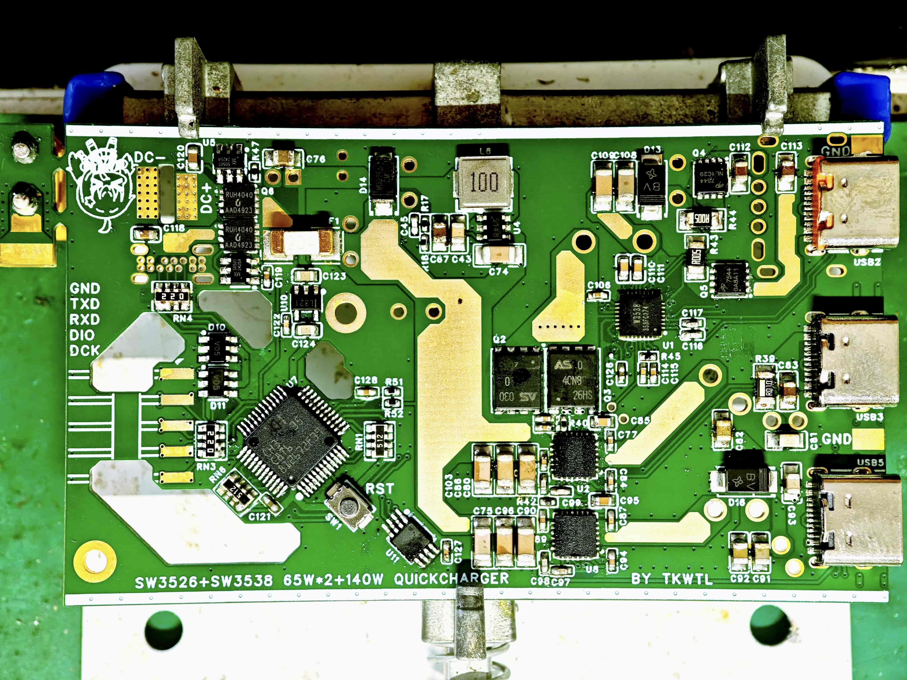

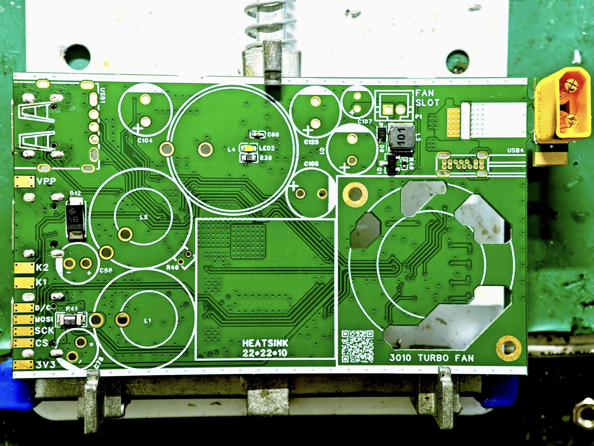

要点:

- 两图分别为**贴片面**(USB 母座、CH32X035 与阻容一侧)与**插件面**(大铜面一侧,
  丝印 `HEATSINK 22*22*10` / `3010 TURBO FAN` / `FAN SLOT`);
- `Q2` / `Q3`(BSC059N04LSG,DFN5×6 带裸露散热焊盘)与 `U4`(LGS5148)是散热与电流关键点:
  散热焊盘必须吃锡、无空洞,贴片面下方需有散热过孔;
- `U7`(CH32X035,QFP)与 `U9` / `U5`(MX5050T)引脚细密,建议钢网印刷 + 回流,
  手贴需放大镜检查连锡;
- 贴片后**先不要焊任何插件**,方便检查与清洗(此时即图 2 的状态)。
- 锡膏焊接后用烙铁处理连锡，并使用无铅高温锡加强type-C插件孔的锡量

检查点:`USB2` / `USB3` / `USB5`(贴片 Type-C 母座)无偏移、无翘脚、引脚无锡连;
阻容无立碑、无锡珠;`Q2` / `Q3` 散热焊盘无空洞。

## 5. 主板插件焊接

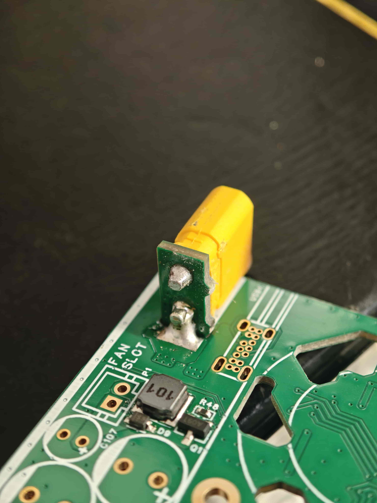

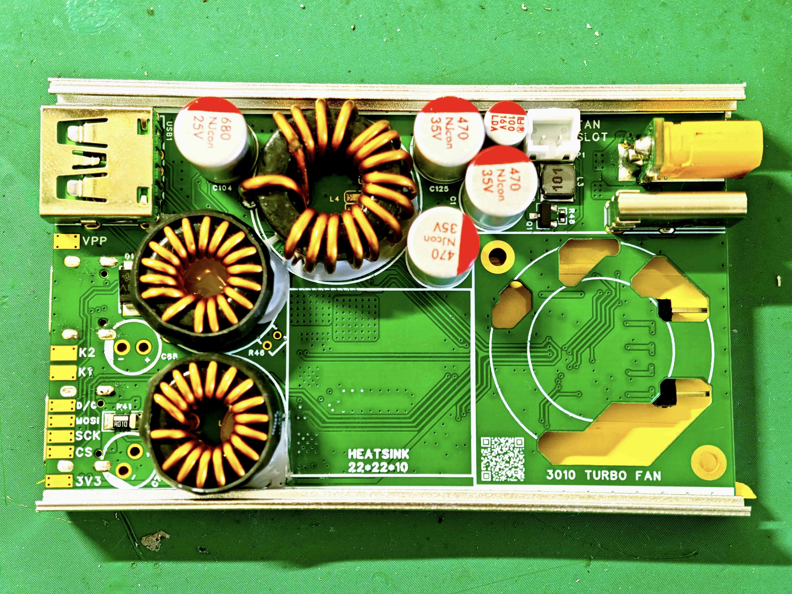

主板插件元件清单(规格取自网表,便于备料核对):

| 位号 | 器件(网表型号) | 规格 / 说明 |
|---|---|---|
| `CN1` | XT30UPB-M | 经小块转接板**竖插**焊装(不是主板原生直插形态),见下方说明 |
| `USB1` | U234-051N-3GRA035-5 | USB-A 母座(插件,9 pin) |
| `USB4` | U264-141N-4BAC10 | USB-C 母座(插件,18 pin,PD 输入) |
| `P1` | JS20T-S02PHA-00 | 风扇座,JST XH 2P(2.0 mm);1 脚 = VPP |
| `L1` `L5` | XR050125TS221MHL5 | 22 µH 环型插件电感(BD15.5 / 脚距 4.0 / 线径 0.8) |
| `L4` | SRT065125HW100MB | 22 µH,SW3538 半桥输出电感 |
| `C104` | 03EC0575 | 电解 470 µF(BD8.0 / 脚距 3.5 mm) |
| `C1` `C105` `C125` | ERS1VM221F12OT | 电解 220 µF(BD8.0 / 脚距 3.5 mm) |
| `C78` `C88` | PA25V220M6x8 | 电解 220 µF(BD6.3 / 脚距 2.5 mm),**本步故意不焊** |
| `C107` | PA16V100M5x7 | 电解 100 µF(BD5.0 / 脚距 2.0 mm) |
| `R46` | MF52A104J3950 | NTC 热敏电阻(10 kΩ / B3950),见 §6 |

> `Q1`(AO3400A,SOT-23)与 `D9`(BAT46WS,SOD-323)是风扇驱动的贴片件,
> 随 §4 一起贴装,不在此表。

> ⚠️ **`C78` / `C88` 这一步故意不焊**:这两只 220 µF 就装在板边锡桥焊盘旁边(靠 USB-A 一侧),
> 先焊会挡住烙铁和视线,导致 §11 的锡桥焊不顺利。留到 §11 焊内面板锡桥时再补上。

焊接顺序建议(**由低到高、由小到大**,避免高件挡住烙铁):

1. 母座与端子:`USB4` → `USB1` → `P1`;
2. 串口/调试口 5PIN 排针 `H1`(见下方说明,注意针头不要超出板边);
3. 环型电感 `L1` / `L5` / `L4`——引脚粗、吃锡量大,**先预热引脚再加锡**,避免虚焊;
4. 电感焊完**涂硅橡胶固定线圈**(见下方说明),等固化后再往下做;
5. 电解电容 `C104` / `C1` / `C105` / `C125` / `C107`——**注意极性**,
   丝印 `+` 与电容本体白条对齐(`C78` / `C88` 按上面说明跳过);
6. 最后焊 `CN1`(XT30 小板,竖插结构,见下方说明)。

> `R46`(NTC)不在这里焊:它要在**散热片装好之后**再焊,以便弯折贴合散热片,
> 见 §6。

> 现场实拍中 XT30(图 3)是先焊的:它位于板边、不受高件遮挡,先焊后焊都可以,
> 按上面的高度顺序焊也没问题。

**环型电感涂硅橡胶(`L1` / `L5` / `L4`)**

- 三个环型电感是插件线包,通电时会有轻微振动与啸叫;
- 焊完电感后,**在电感底面/线包与 PCB 之间涂一圈硅橡胶(硅酮胶/RTV)**,
  把线圈与骨架固定在板面上,减小振动与噪声;
- 薄薄一层即可,不要流进焊盘、不要涂到电感磁芯以外的元件上;涂完等表干/固化
  再装散热片与风扇。

**串口 / 调试口 5PIN 排针(`H1`,X6511WRS-05H,5P 弯针)**

- `H1` 就是串口 + WCH-Link 调试口:1 脚 `GND`,其余 4 脚为 `DIO` / `DCK` / `TXD` / `RXD`
  (后四路各串 22 Ω 排阻 `RN3`);
- 它是**贴片封装的弯针**,可以在贴片阶段一起过回流,也可以在这一步手工补焊;
  手工焊时先把针脚对准焊盘、定位焊两端,再逐个补锡;
- 焊接时**必须保证针头不超出板边**:针脚端面与板边齐平或略微缩进;
  针头伸出去会在装壳时顶住外壳/被挤压变形;
- 弯针的出线方向朝外、与外壳开窗一致;焊后逐脚轻推确认不松动。

**关于 `CN1`(XT30)**

- 主板上的 XT30 **不是原生直接插焊**:而是先把 XT30 焊在一块小块转接板上,
  再把这块小板**竖插**焊到主板的对应焊盘上(图 3);
- 焊接要点:小板要**垂直**于主板、贴合焊盘,焊后不得歪斜或受力翘起;
- 小板两面焊盘都要透锡,竖插时不要压弯小板;焊完从侧面目检是否垂直。

要点与检查:

- `CN1` 与 USB 母座的固定脚必须**透锡到孔壁**,否则插拔受力会拉掉焊盘;
- 电感的引脚应能看到焊锡爬升到引脚根部;相邻焊盘之间不能连锡(见图 5 中三个电感的间距);
- 焊后按 §1 的清洗剂要求清洗助焊剂残留(**不要用无水乙醇**),尤其功率路径与 USB 母座内部;
- 插件全部焊完即为图 5 状态(`C78` / `C88` 两个位置此时留空),此时**先不要装散热片与风扇**。

## 6. 热敏电阻、散热片与风扇

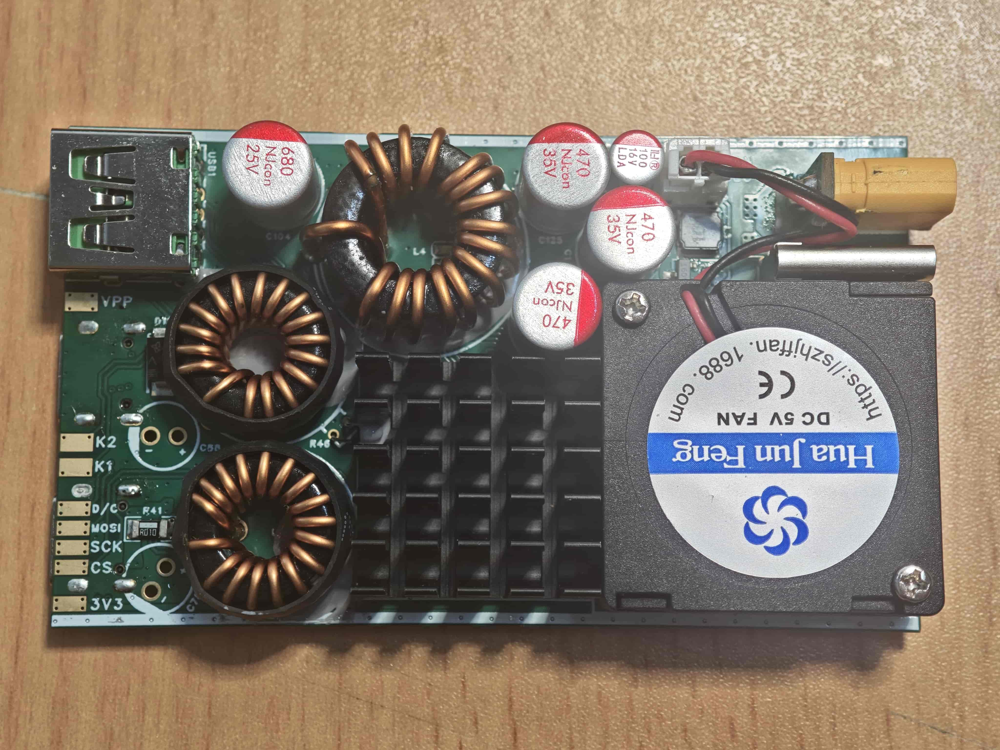

三样东西都在插件面上,顺序:**散热片 → NTC → 风扇**——先装散热片,NTC 才好弯折贴上去。

**散热片(丝印 `HEATSINK 22*22*10`)**

- 22×22×10 mm 铝挤散热片,装在 `Q2` / `Q3` 与电感上方的散热区内;
- **安装方向按图 6**:整机风道是「主板下方开孔吸风 → 散热片 → 其它元器件 → 上层出风口」,
  散热片一定要按这个方向装,鳍片朝向来风、把风导向板内其它元器件;装反会把风道堵在半路,
  满载时散热效果明显变差;
- 散热片与器件之间用**导热双面胶**贴固(见 §3.1 B 表),不要直接压在裸露焊盘/引脚上;
- 装好后确认不与其他元件、螺钉、外壳短路。

**NTC(`R46`,MF52A104J3950)**

- 焊在插件面、靠近功率级与散热片的位置,引脚与焊盘一一对应(无极性);
- NTC 一端接 **SW3538 的 NTC 引脚**(U1 pin 24),另一端接 GND;
  固件经 SW3538 的 NTC ADC 读取,仪表盘上记为 **Temp#2**;
- **必须在散热片装好之后再焊**:焊前先把 NTC 引脚**弯折**成能贴到散热片侧面的形状,
  焊接后让本体贴紧散热片表面,**涂导热胶固定**(或用 Kapton 胶带压住),
  让读数跟随功率级温度而不是环境温度;
- 弯折时靠近本体根部留一点余量,不要从根部折死,避免断脚。

**风扇(丝印 `3010 TURBO FAN`)**

- 3010 涡轮风扇、**DC 5 V**,用螺丝固定在 `3010 TURBO FAN` 丝印区域内,出风朝散热片;
- 供电接 `P1`(JST XH 2P):**1 脚 = VPP**,2 脚经 `L3`(100 µH)/`D9`(BAT46WS) 与
  `Q1` 低边 PWM 驱动,`PB9` 输出 187.5 kHz PWM,等效平均电压低于 9 V,适配 5 V 风扇;
- ⚠️ **接线有极性,装之前务必核对**:`P1` 的 **1 脚是 VPP(正)**,风扇红线接 1 脚、
  黑线接 2 脚;JST XH 端子的压接方向与插入方向都要对,插反风扇不转、也可能损坏;
- 螺钉不要顶到扇叶;线束走向避开电感与半桥,建议用胶带/绑线固定;
- 通电验证:温度 ≥40 °C 时风扇起转(固件曲线见
  [`../Firmware/BSP/Fan/README.md`](../Firmware/BSP/Fan/README.md);
  **占空比 0–48 不启动、48–72 会啸叫,属正常**,固件会直接从 0 跳到 80)。

## 7. 插件面检查

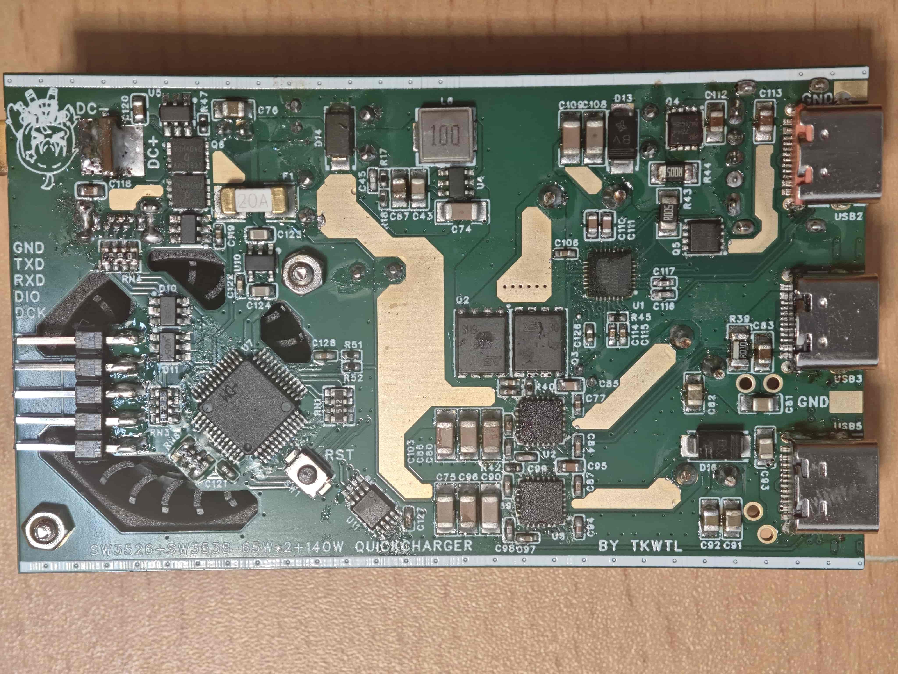

- [ ] 电感、电解、XT30、USB 母座的引脚在 SMT 面**全部可见透锡**,无发黑/未润湿;
- [ ] 相邻引脚无连锡(电感引脚之间、电解负极与铺铜之间);
- [ ] 电解极性全部正确(`+` 丝印 ↔ 本体白条);
- [ ] `C78` / `C88` 两个位置**仍留空**(按 §5 要求,留到 §11 补焊);
- [ ] `H1`(调试口 5P 弯针)**针头没有超出板边**;`CN1`(XT30 小板)垂直、不歪斜;
- [ ] 三个环型电感的硅橡胶已固化,线圈不晃;
- [ ] 插件高度不超高,`USB4` / `USB1` 口与面板开孔对得上(见 §10);
- [ ] 助焊剂残留已清洗、板面无锡珠。

## 8. 内面板贴片与按键

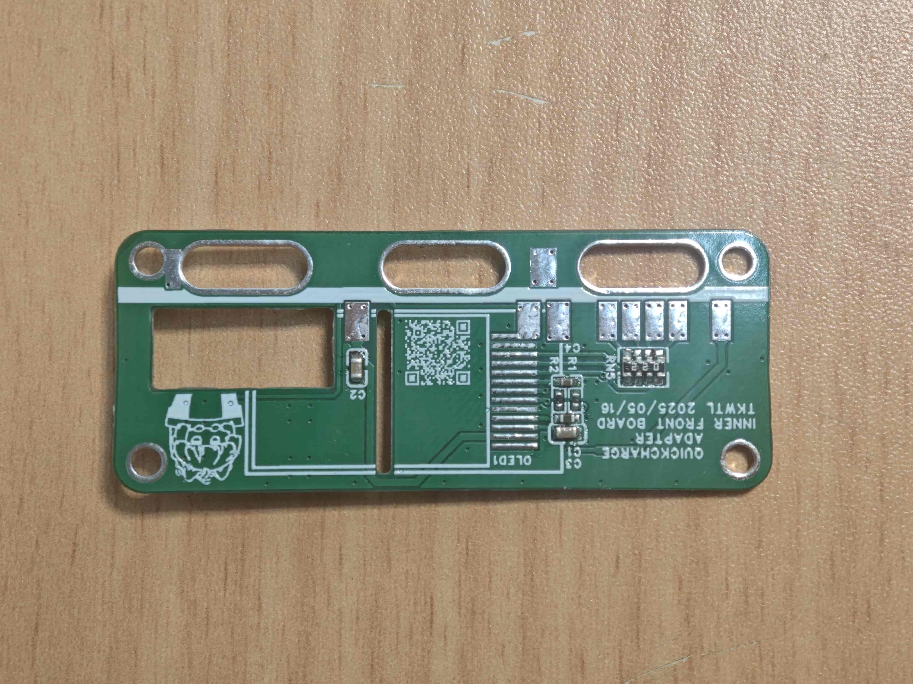

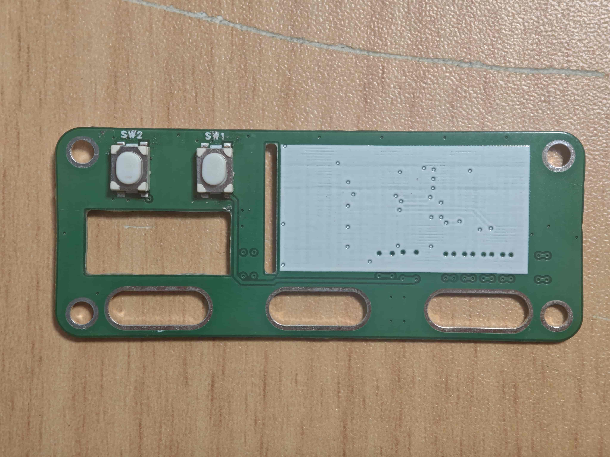

内面板元件很少,一次回流即可完成:

| 位号 | 器件 | 规格 |
|---|---|---|
| `OLED1` | 0.78″ OLED(SH1107,TK078F288,13 pin FPC) | 排线**直接焊接**,见 §9 |
| `SW1` `SW2` | SKRPACE010 轻触按键 | 对应面板 `ENTER` / `NEXT` |
| `C1` | 4.7 µF(0402) | |
| `C2` `C3` | 2.2 µF(0603) | |
| `C4` | 1 µF(0402) | |
| `R1` | 750 K(0402) | 屏复位 RC |
| `R2` | 10 K(0402) | |
| `RN5` | 22 Ω ×4 排阻(0603-8P) | SPI 线串阻,无极性要求 |

要点:

- `SW1` / `SW2` 焊在按键面(图 9),按键帽朝外,焊好后应先与外面板试配合,
  确认按键能顺畅穿出面板孔再焊屏;
- `RN5` 这类 8P4R 排阻**没有极性要求**:内部是 4 个独立电阻,按「1-8、2-7、3-6、4-5」
  成对跨接,旋转 180° 后每一对焊盘仍然接同一个电阻,**装反也能正常工作**;
  丝印方向保持一致只是为了检修时好看、好对照;
- 内面板板边有一排信号焊盘(`VPP` / `3V3` / `K1` / `K2` / `D/C` / `MOSI` / `SCK` / `CS`),
  这些焊盘**不要提前堆锡**,留到 §11 与主板对位后再上锡;
- `OLED1` 的 13 个焊盘同样先保持平整,留到 §9 焊屏。

## 9. OLED 就位与排线直焊

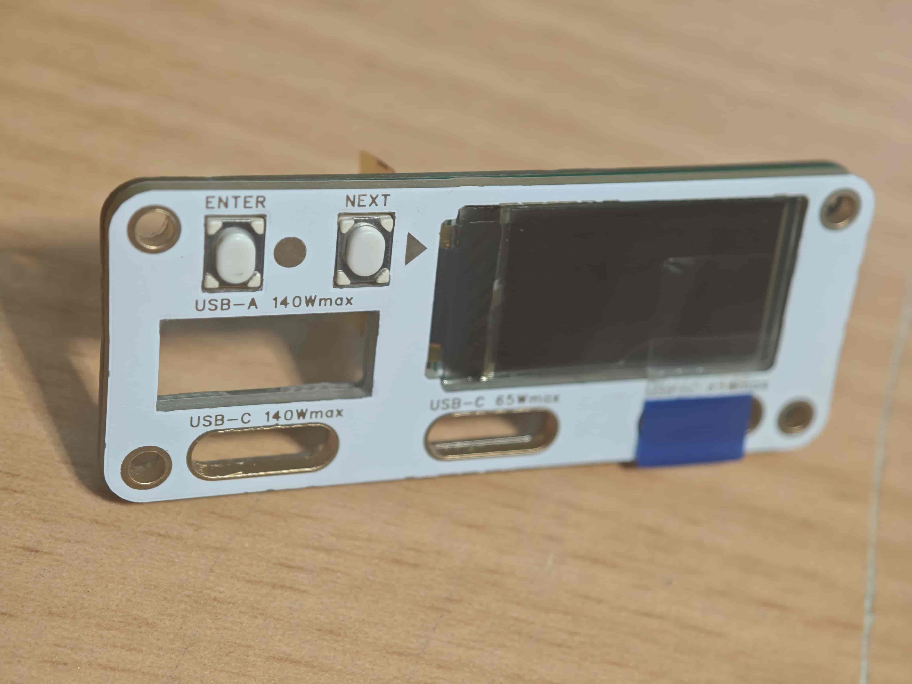

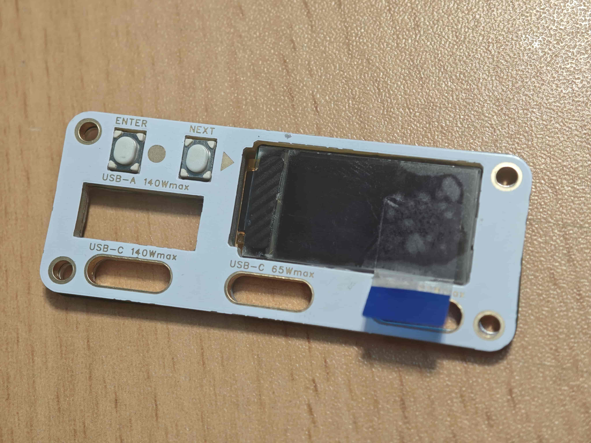

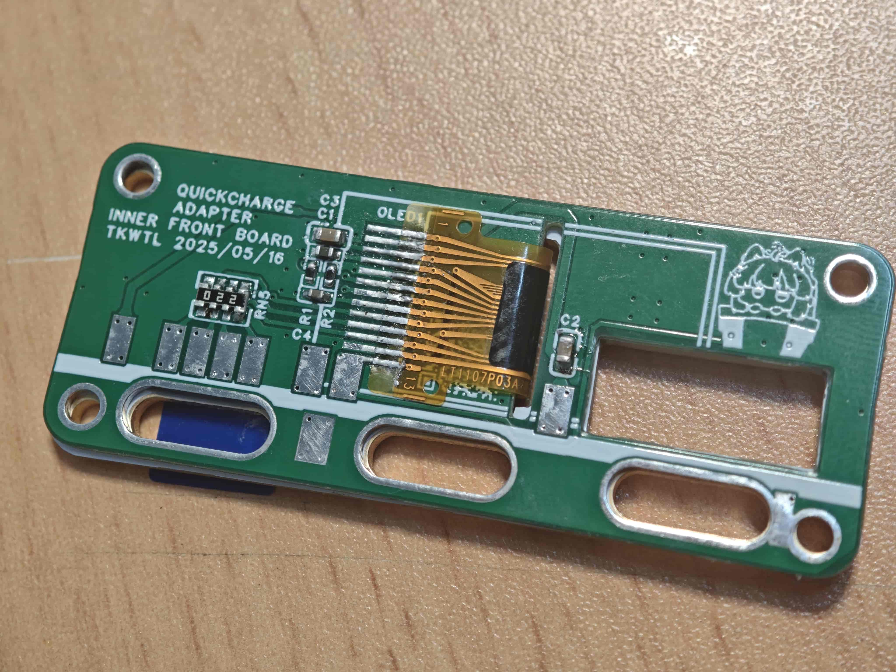

**顺序很关键:先在面板窗口里定位,再焊 FPC。** 一旦焊上,屏幕位置就固定了。

1. 把 OLED 从外面板窗口放入,让显示区与窗口对齐、四边留缝均匀(图 10);
2. 用**普通双面胶或胶水**把屏粘到窗口后面的合适位置就够了(图 11):
   OLED 背面是玻璃,不需要垫任何东西,也不用绝缘胶带——塞垫片会把屏顶起、产生应力;
3. 内面板装到屏后方,把 FPC 的 13 个焊盘与板上的 `OLED1` 焊盘对齐;
4. **用锡膏 + 拖焊(Drag)焊,不要逐脚堆锡**:
   - 先顺着这 13 个焊盘**涂一条锡膏**(连续一条即可,量宁少勿多);
   - 把 FPC 对准放上去,让锡膏被**压在 FPC 下面压扁**;
   - 烙铁从**中间**开始焊——**从两端起焊容易把中间顶起来**;
   - 固定住中间之后,再从中间**往两边拖/脱**,靠热量与下压把锡推到两侧;
   - 只要**充分加热并压紧**,多余的锡会从 FPC 下面挤出来,不会形成连锡;
   - 前提是烙铁温度够、单点停留时间短(刀头 + 足量助焊剂),FPC 本身不耐久热;
5. 焊完目检 + 万用表逐脚通断(相对 FPC 端),再上电点亮(图 12)。

注意事项:

- **这是直焊方案,没有连接器**:返修必须解焊 FPC,屏幕基本不可重复拆装,焊接前务必确认对位;
- FPC 弯折半径要留足,不要压在面板开孔边缘或螺钉柱上;
- 屏的 `VPP` 由主板经板间焊盘提供,固件初始化显式关闭内部电荷泵(`0xAD, 0x8A`),
  所以**不接主板时屏不会亮**,不要误判为屏损坏。

## 10. 外壳绝缘与结构预装配

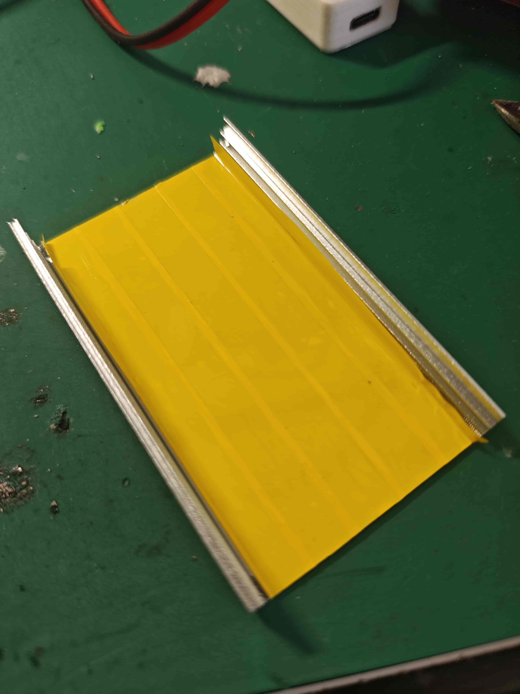

**本节必须在 §11 锡桥连接之前完成**——先借外壳把两块板定位好,锡桥的位置才对得上。

**外壳绝缘(只贴内底面,必做)**

- **只需要对铝型材外壳的内底面(贴板子焊点的那一面)贴耐温绝缘胶带**(黄色高温胶带,图 4);
- **内顶面不贴**:那一面没有电气连接、也没有裸露焊盘,不需要贴;
- 胶带要覆盖板子与内底面可能接触的平面与棱边,贴平、不重叠起皱,避免装板时被推挤脱落;
- 目的:防止 PCB 底面焊点(尤其 USB 母座固定脚、电感引脚、后面补焊的 `C78` / `C88` 焊点)
  与铝壳短接。

**结构预装配(以壳体作为定位基准)**

1. 主板沿铝型材**预置的 PCB 槽**推入,确认到位、不翘、不与外壳短接;
2. 内面板用螺丝固定到外壳上(此时**先不要**与主板焊在一起);
3. 检查两块板的板边焊盘是否**在同一平面、逐一对齐**:位置由外壳决定,
   对不齐时先查槽位与螺丝有没有压到底,不要用焊锡去迁就;
4. 外面板与背板此时先不装,方便 §11 的焊接与检查。

## 11. 主板 ↔ 内面板 锡桥连接

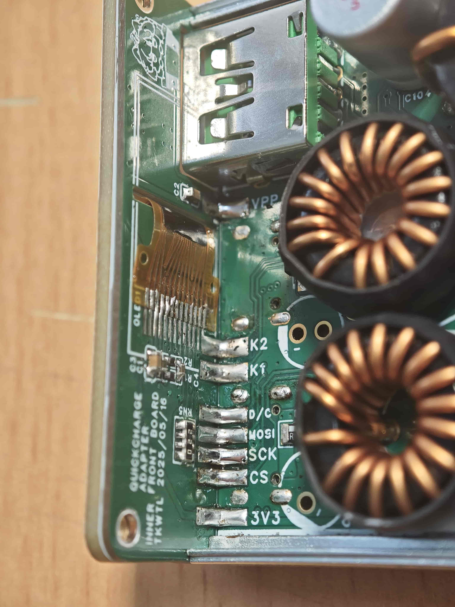

两板之间**不使用连接器**:两块板在同一平面并排,板边各有一排**同名焊盘**
(两板丝印一致,便于对位),用焊锡把每一对同名焊盘搭在一起(图 13)。信号共 9 路:

| 焊盘 | 含义 |
|---|---|
| `VPP` | 9 V,给 OLED 的 VPP |
| `3V3` | 3.3 V,OLED VDD 与逻辑 |
| `GND` | 地 |
| `K1` `K2` | SW1 / SW2 按键 |
| `D/C` | OLED 数据/命令 |
| `MOSI` `SCK` `CS` | OLED SPI |

操作要点:

- 两块板已在 §10 由外壳定位好,**直接在装机状态下焊接**,焊完不要再拆装;
- 从一端开始逐点加锡:烙铁压住两个焊盘交界,加少量锡形成桥,**每个桥不要过大**,
  避免爬到相邻焊盘;
- `VPP` / `3V3` / `GND` 三根是电源,焊锡量可略多;信号桥只要连通即可;
- **锡桥焊完,再把 §5 留空的 `C78` / `C88` 补焊上**:这时不再需要给烙铁让位置,
  照常装这两只 220 µF 电解(极性照旧,`+` 对丝印);
- 焊后**逐路用万用表导通检查**,并确认电源与相邻信号之间不短路(重点查 `VPP` ↔ `3V3` ↔ `GND`);
- 锡桥区紧邻外壳内壁(图 13 左侧即铝型材),焊点要平、不能有锡刺,用锉刀/烙铁
  修平,避免顶穿 §10 贴的绝缘胶带;
- 焊好后两板成为一体,返修需把锡桥全部吸掉,**装机前请先完成 §8/§9 的自检**。

## 12. 焊后检查(首次上电前)

- [ ] 目检:无连锡、无虚焊、极性正确,锡桥区无毛刺;
- [ ] `C78` / `C88` 已在 §11 补焊,且极性正确;
- [ ] `3V3` 对 `GND`、`VPP` 对 `GND` 阻抗正常(无短路);
- [ ] 各 USB 口的 `VBUS` 对 `GND` 不短路;`CN1` 正负极与丝印一致;
- [ ] 风扇座 `P1` 的 1 脚(VPP)与风扇线正极对应;
- [ ] 板组件与外壳之间绝缘良好(万用表测板底焊点对外壳)。

## 13. 单板/整机首次上电

> **新芯片(未烧录固件)第一次上电会自动进入出厂 ISP 模式**——此时不会有串口横幅
> 和 OLED 输出,属正常现象:先按 §14 烧录固件,再回到本节做检查。
> 已烧录过固件的板子上电才会直接运行程序。

- [ ] 可调电源**限流**上电(建议先 5 V / 小电流档,确认控制器不发热、电流不异常);
- [ ] 串口(`PB10`/`PB11` @921600)能看到启动横幅与 `[RESET] cause`;
- [ ] OLED 点亮并进入仪表盘;
- [ ] 温度读数合理(非 `--.-C`;`Temp#1` = GX21M15U 板温,`Temp#2` = NTC);
- [ ] 输入电压 / 功率预算显示与实际输入一致。

**串口启动横幅对照**(SW3538 接入电压时的实测打印,921600 8N1):

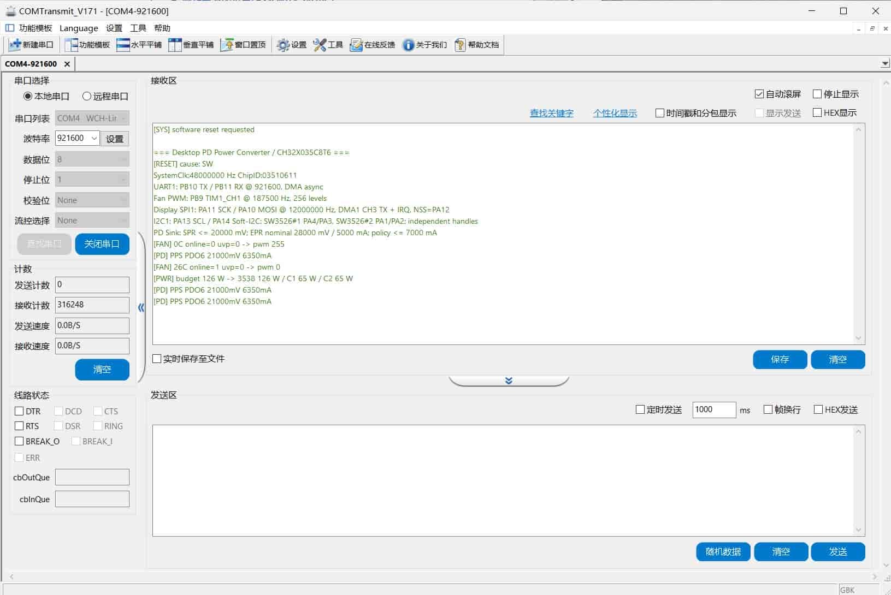

认这几行就能判断板子起没起来:

| 打印行 | 含义 |
|---|---|
| `=== Desktop PD Power Converter / CH32X035C8T6 ===` | 固件版本横幅,出现即表示已正常启动 |
| `[RESET] cause: SW` / `PIN` / `IWDG` | 复位来源;软复位为 `SW`,上电为 `PIN`,看门狗为 `IWDG` |
| `SystemClk:48000000 Hz ChipID:...` | 主频与芯片 ID,时钟配置正确才会出现 |
| `Fan PWM: PB9 TIM1_CH1 @ 187500 Hz` | 风扇 PWM 初始化成功 |
| `Display SPI1: PA11 SCK / PA10 MOSI ...` | OLED SPI 初始化 |
| `I2C1: PA13 SCL / PA14 SDA Soft-I2C; SW3526#1 PA4/PA5 ...` | 软 I²C 与两颗 SW3526 挂载 |
| `PD Sink: SPR <= 20000 mV; EPR ...` | PD Sink 策略生效 |
| `[PWR] budget 126 W -> ...` | 功率预算已按输入算出 |

> 没看到横幅时:先确认串口线接在 `H1` 的 `TXD`/`RXD`(§14 方法 2)、波特率 921600、
> 且板子是**已烧录**状态;全新芯片上电进 ISP 是没有这串打印的。

## 14. 固件烧录

两种方式,均为 WCH 官方工具:

> **全新装配、MCU 未烧录的板子第一次上电会自动进入出厂 ISP 模式**,不需要任何菜单操作,
> 直接按方法 1 连电脑即可被 WCHISPStudio 识别。菜单里的 `Reboot to ISP`
> 是给「已烧录固件、想再次升级」的设备用的。

**方法 1:USB 直接下载(推荐,免拆机)**

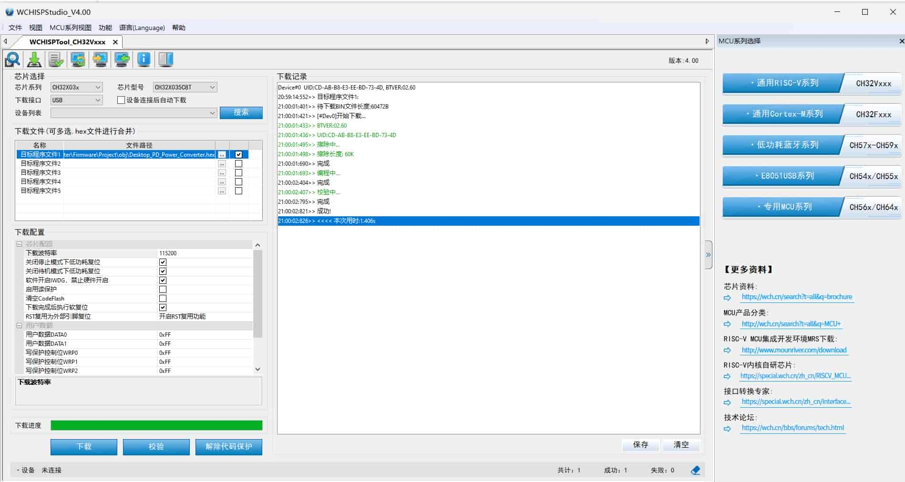

1. 电脑安装 **WCHISPStudio**(图 15 为 V4.00);
2. 准备固件 `.hex`,二选一:
   - **直接用仓库里的构建产物**:
     [`Firmware/Project/obj/Desktop_PD_Power_Converter.hex`](../Firmware/Project/obj/Desktop_PD_Power_Converter.hex)
     (已在版本库内,点开即可下载);
   - 或从仓库 **GitHub Releases** 下载;也可以自己用 MounRiver 构建生成;
3. 用 USB 线把设备的 **`USB4`(PD 输入口)** 接到电脑;
4. 让设备进入 ISP:
   - **新芯片 / 未烧录**:上电即自动进入出厂 ISP,无需操作;
   - **已烧录固件**:在设备上操作 **菜单 → 系统设置**,把光标移到最末一项
     **「重启至ISP模式」**,按 `ENTER` 确认(界面见下方图);
     - 固件默认中文界面,所以菜单项是中文;**若已把 Language 关掉切成英文**,
       该项显示为 **`Reboot to ISP`**;
     - 进菜单与选项目的操作见 [`USER_MANUAL.md`](USER_MANUAL.md) §5.2 / §6;
5. 在 WCHISPStudio 里设置(与图 15 一致):
   - 芯片系列 `CH32X03x`,芯片型号 `CH32X035C8T6`;
   - 下载接口选 **`USB`**,点「搜索」让它识别到设备;
   - 「下载文件」里选择第 2 步的 `.hex`(目标程序文件 1);
6. 点 **「下载」**;进程栏出现 `下载中 → 校验中 → 成功`,并给出本次用时
   (图 15 为 `成功,本次用时1.40s`),右侧「下载记录」会逐行打印设备序列号与结果;
7. **下载成功后的现象**:设备自动复位运行,OLED 进入**主界面**(仪表盘)。
   此刻设备由电脑 USB 的 5 V 供电,因此:
   - 第 1 行输入电压应显示 **`5V`**,功率预算 `0Wmax`,`PD` 状态显示 **`UVP`**
     (5 V 低于 8 V 欠压门限,属正常,不代表故障);
   - 三列 `TypeA+C` / `TypeC1` / `TypeC2` 的电压电流应接近 0,协议列显示 `NC`。
   参考画面见 [`../Images/Product/主界面-5V输入.jpg`](../Images/Product/主界面-5V输入.jpg)。

> 若下载后屏幕全黑:先确认 `C78`/`C88` 已补焊(§11)、`3V3` 与 `VPP` 阻抗正常(§12);
> 若 WCHISPStudio 搜不到设备:检查 USB 线是否只供电不能传数据,以及设备是否真的进入了 ISP。

**进入 ISP 的菜单路径**(默认中文界面):

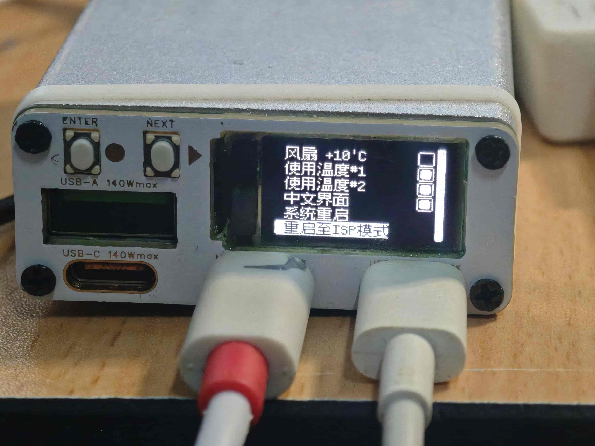

菜单 → **系统设置**,最末一项就是 **「重启至ISP模式」**;上面的「风扇 +10'C」、
「使用温度#1/#2」、「中文界面」都是普通开关项,「系统重启」只做软复位、**不进 ISP**。

> ⚠️ **不慎进入 ISP 模式的恢复方法**:ISP 模式下屏幕不显示主界面,只能被电脑端工具识别。
> 只要**拔掉所有接口让整机彻底断电**——XT30 输入、USB 输入与全部输出线、以及串口/调试线
> (`GND` / `DIO` / `DCK`)——**再重新上电**,设备就会正常启动回到主界面。
> 注意线缆没拔净时(尤其 PD 输入与调试线会倒灌供电)不算断电,断电要断干净。

**方法 2:WCH-LinkE 调试下载**

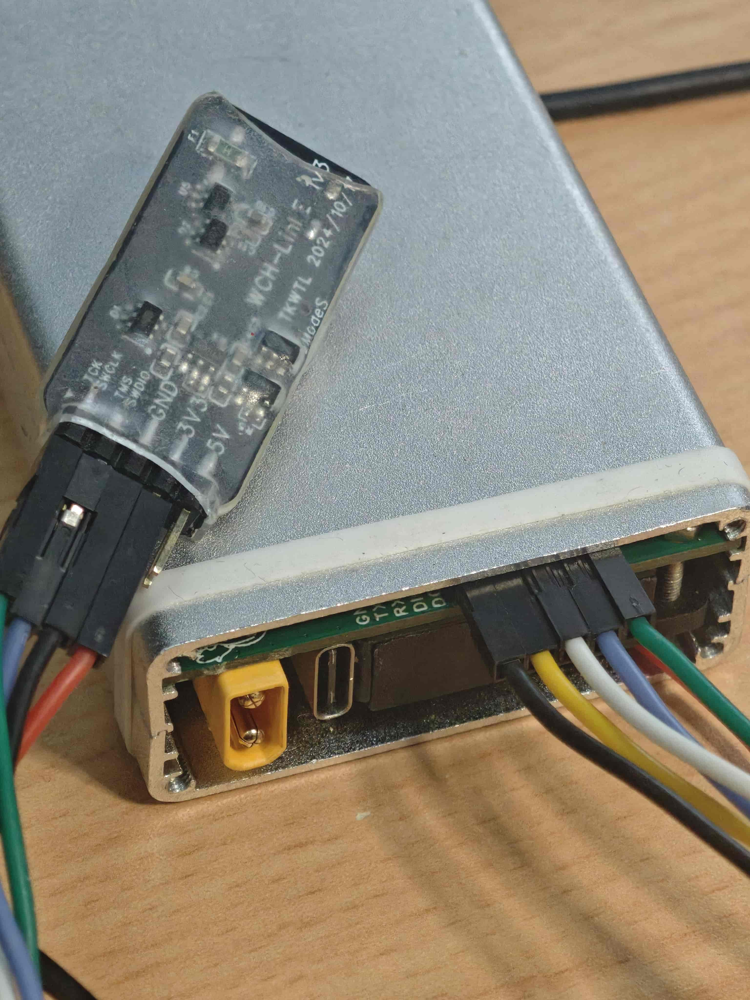

1. 准备 **WCH-LinkE**:市售的可以,也可以像图 16 那样**用一块自制的 WCH-LinkE 小板**
   (板上印 `WCH-LinkE` / 版本号,一侧是 USB 口,另一侧是 SWD/串口引脚);
2. 打开后盖,找到主板调试口 `H1`(5 pin,丝印为完整的 **`GND` / `TXD` / `RXD` / `DIO` / `DCK`**;
   图 16 里被杜邦线挡住,只露出前半截,按全长丝印认脚位);
3. 按下表接线(杜邦线直接插到 `H1` 的排针上,图 16):

   | `H1` 脚位 | 丝印 | 接到 WCH-LinkE |
   |---|---|---|
   | 1 | `GND` | **GND**(必接) |
   | 2 | `TXD` | 可选:接 USB-串口模块的 RX,用来看串口日志 |
   | 3 | `RXD` | 可选:接 USB-串口模块的 TX |
   | 4 | `DIO` | **SWDIO / DIO**(必接) |
   | 5 | `DCK` | **SWCLK / DCK**(必接) |

   > 只下载固件时接 **`GND` + `DIO` + `DCK`** 三根就够;把 `TXD`/`RXD` 也接上,
   > 就能同时用串口(921600)看启动横幅与 `[RESET] cause`。
4. **不要接 3V3/5V 供电**:下载时由设备自己供电即可,别把调试器的电源引到板上;
5. 在 **MounRiver Studio II**(工程 `Firmware/Desktop_PD_Power_Converter.wvproj`)
   或 **WCH-LinkUtility** 中选择 `CH32X035`,点下载;
6. 接线注意:杜邦线别插错脚位(`DIO`/`DCK` 反了会连不上芯片),插针式排线**不要带着线缆
   拽板子**,避免把 `H1` 的焊盘扯起(§5 已要求针头不超板边)。

> 用户侧说明见 [`USER_MANUAL.md`](USER_MANUAL.md) §11 固件升级。

## 15. 功能验证与 Type-C 铁壳补强

**先验证功能,再做补强**——顺序不能颠倒。

**15.1 功能验证(必须全部通过)**

- [ ] **UI 操作**:`ENTER` / `NEXT` 两个键能翻页与调值,OLED 无花屏/缺行,对比度、休眠正常;
- [ ] **三路输出**:A+C、C1、C2 分别单独带载都能正常握手、出压、带载;
- [ ] 插拔各口时功率分配会重新计算,仪表盘数值刷新正常;
- [ ] 风扇到 40 °C 起转,温度读取正常。

**15.2 Type-C 铁壳补强(15.1 全部通过后再做)**

- 把靠近内面板一侧的两个 Type-C 母座(`USB3` / `USB5`)的**铁壳前缘**加锡,
  与内面板板边焊连成一体,提高插拔时的抗拉强度;
- 这是**机械补强**,不改电路;补强后这两只母座的返修余量很小,所以才要等 UI 与
  三路输出都验证正常再动;
- 加锡量适中:不要流进母座口内,也不要碰到旁边的 `C93` / `R39` / `D16` 等元件;
- 补强后重新插拔各 5 次以上,确认无异响、无松动、端口功能仍然正常。

## 16. 整机首次上电与验收

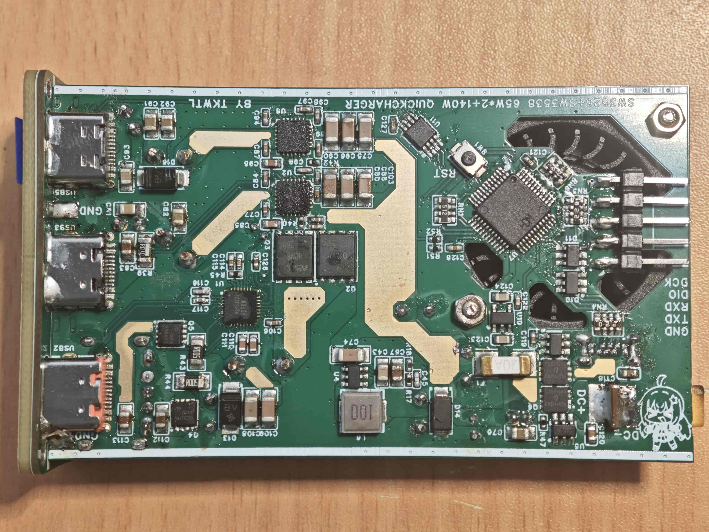

> 上图拍摄于 **`C78` / `C88` 已补焊、Type-C 铁壳补强已完成**之后的状态:
> 三个 Type-C、USB-A、`RST` 按键、调试焊盘 `GND/TXD/RXD/DIO/DCK` 都可访问,
> 可作为最终装配的对照参考。

- [ ] 空载上电:仪表盘正常、无异常复位;
- [ ] 插入 USB 设备:协议列由 `5V` 变为协议名;
- [ ] 接入 PD 电源:状态栏出现 `SPR`/`EPR`;接 XT30 时显示 `DC`;
- [ ] 温度上升、到 40 °C 风扇起转,风噪随温度增加;
- [ ] 插拔各口:功率分配自动重新计算(见 [`USER_MANUAL.md`](USER_MANUAL.md) §7);
- [ ] 结构:无松动、无异响、按键正常,屏无应力纹;
- [ ] 装外面板与背板(内面板与外面板先对位:键位、屏窗、三个输出口开孔;
      外面板丝印为 `ENTER` / `NEXT`、`USB-A 140Wmax`、`USB-C 140Wmax`、`USB-C 65Wmax`),
      螺钉**对角均匀拧紧**,不要一次拧死单颗;
- [ ] 检查按键手感与键程、屏窗无遮挡、USB 口与面板开孔齐平;
- [ ] 记录:整机序列号 / 日期 / 固件版本(建议写入机内标签)。

> **主界面对照**(成品实机截图,`Images/Product/`):
> [5 V 输入](../Images/Product/主界面-5V输入.jpg)(UVP,同 §14 烧录后现象)、
> [21 V 6.35 A 输入](../Images/Product/主界面-21V-6.35A输入.jpg)、
> [28 V 5 A 输入](../Images/Product/主界面-28V-5A输入.jpg);菜单与设置页见
> [主菜单](../Images/Product/主菜单.jpg)、[系统设置界面](../Images/Product/系统设置界面.jpg)。

> 单机验收的测量项目(纹波、半桥波形、满载温升)与记录模板见
> [`TEST_REPORT.md`](TEST_REPORT.md)。

## 17. 常见装配问题

| 现象 | 优先排查 |
|---|---|
| OLED 全黑 / 花屏 / 局部缺行 | FPC 焊点虚焊或错位(§9);未接主板时无 VPP 不亮属正常 |
| 按键无反应或串键 | `K1` / `K2` 锡桥漏焊或与相邻焊盘短路(§11);`SW1`/`SW2` 虚焊 |
| 风扇不转 | `P1` 极性接反;温度未达 40 °C;固件占空比落在 0–72 区间(§6) |
| 风扇啸叫 / 时转时停 | 占空比停在 48–72 区间;检查 `Q1`、`L3`、`D9` 焊接 |
| 温度显示 `--.-C` | `GX21M15U`(U11)或 NTC(`R46`)未焊 / 虚焊,或 I²C 异常 |
| 某口无输出 | 该口 USB 母座固定脚未焊透、`VBUS` 未通;或对应控制器虚焊 |
| 一插就保护 / 输入短路 | 输入 OR-ing 区(`Q6`/`Q7`、`F1`)连锡;板底与铝壳短接(§10 绝缘) |
| 屏亮但白屏 / 对比度异常 | 屏 `VPP` 未到、`R1`/`C3` 复位 RC 焊接不良 |
| `C78` / `C88` 漏装 | 按 §11 补焊;漏装会让 VBUS 储能不足,大载时纹波变大、易掉压 |
| 插拔后某口松动 / 接触不良 | 该口未做 §15.2 铁壳补强,或补强锡量过大顶住内壁 |

---

## 附录:关键接口速查

| 项目 | 参数 |
|---|---|
| 调试串口 | `PB10`/`PB11`,921600 8N1 |
| 烧录 / 调试焊盘 | `GND` `TXD` `RXD` `DIO` `DCK` |
| 风扇 PWM | `PB9`(TIM1_CH1),187.5 kHz,占空比 0–255 |
| 温度源 | Temp#1 = `GX21M15U`(I²C 板温);Temp#2 = `R46` NTC(经 SW3538 读取) |
| 板间信号 | `VPP` `3V3` `GND` `K1` `K2` `D/C` `MOSI` `SCK` `CS` |
| 屏幕 | 0.78″ SH1107(80×128 原生,横屏 128×80),13 pin FPC 直焊,SPI |
| 输入 | `CN1` XT30(DC)/ `USB4` USB-C PD(EPR 28 V / 5 A) |
| 输出 | A+C(SW3538,≤140 W 合计)/ C1、C2(SW3526,各 ≤65 W) |

## 附录:实拍图索引

装配过程照片位于 [`../Images/Assembly/`](../Images/Assembly/),文件名前缀即装配顺序:

| 序 | 文件 | 内容 | 对应章节 |
|---|---|---|---|
| 1 | [1-背面贴片.jpg](../Images/Assembly/1-背面贴片.jpg) | 主板 SMT 面贴片完成(USB 母座 / MCU 一侧) | §4 |
| 2 | [2-正面贴片.jpg](../Images/Assembly/2-正面贴片.jpg) | 主板插件面(SMT 贴片已完成,插件尚未焊) | §4 |
| 3 | [3-安装XT30口.jpg](../Images/Assembly/3-安装XT30口.jpg) | CN1(XT30 经小块转接板竖插)焊接 | §5 |
| 4 | [4-外壳绝缘.jpg](../Images/Assembly/4-外壳绝缘.jpg) | 铝型材外壳**内底面**贴绝缘胶带 | §10 |
| 5 | [5-部分插件.jpg](../Images/Assembly/5-部分插件.jpg) | 环型电感、电解电容、风扇座等插件焊完(本步不含 `C78`/`C88`) | §5 |
| 6 | [6-热敏电阻、散热片与风扇.jpg](../Images/Assembly/6-热敏电阻、散热片与风扇.jpg) | 散热片、NTC 与风扇安装 | §6 |
| 7 | [7-插件后背面.jpg](../Images/Assembly/7-插件后背面.jpg) | 插件焊完后从 SMT 面检查引脚透锡 | §7 |
| 8 | [8-面板背面贴片.jpg](../Images/Assembly/8-面板背面贴片.jpg) | 内面板 SMT 面贴片完成(OLED 焊盘 / 阻容 / 排阻) | §8 |
| 9 | [9-面板正面按键.jpg](../Images/Assembly/9-面板正面按键.jpg) | 内面板按键面:SW1 / SW2 焊好 | §8 |
| 10 | [10-安装屏幕.jpg](../Images/Assembly/10-安装屏幕.jpg) | OLED 放入外面板窗口定位 | §9 |
| 11 | [11-安装屏幕.jpg](../Images/Assembly/11-安装屏幕.jpg) | 屏与面板窗口配合、用双面胶/胶水固定到位 | §9 |
| 12 | [12-焊接屏幕.jpg](../Images/Assembly/12-焊接屏幕.jpg) | OLED 13 pin FPC 直接焊到内面板焊盘 | §9 |
| 13 | [13-锡桥连接.jpg](../Images/Assembly/13-锡桥连接.jpg) | 内面板 ↔ 主板 板边焊盘锡桥连接 | §11 |
| 14 | [14-背面总览.jpg](../Images/Assembly/14-背面总览.jpg) | 最终总览:**`C78`/`C88` 补焊后**、Type-C 铁壳补强完成后 | §16 |
| 15 | [15-WCH_ISP下载.jpg](../Images/Assembly/15-WCH_ISP下载.jpg) | WCHISPStudio 下载固件:芯片型号、USB 接口、hex 路径与「成功」记录 | §14 |
| 16 | [16-自制WCHLinkE连接主板.jpg](../Images/Assembly/16-自制WCHLinkE连接主板.jpg) | 自制 WCH-LinkE 用杜邦线接主板 5PIN 调试口(`GND/TXD/RXD/DIO/DCK`) | §14 |

> 图片体积较大(单张 0.3–1.1 MB),若需压缩到仓库约定(≤500 KB)见
> [`../Images/README.md`](../Images/README.md)。
